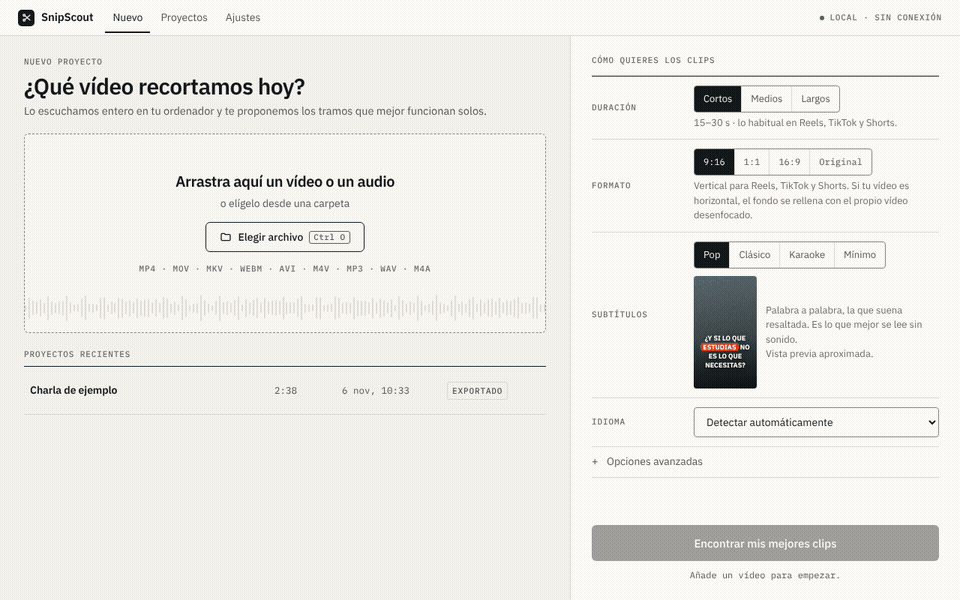
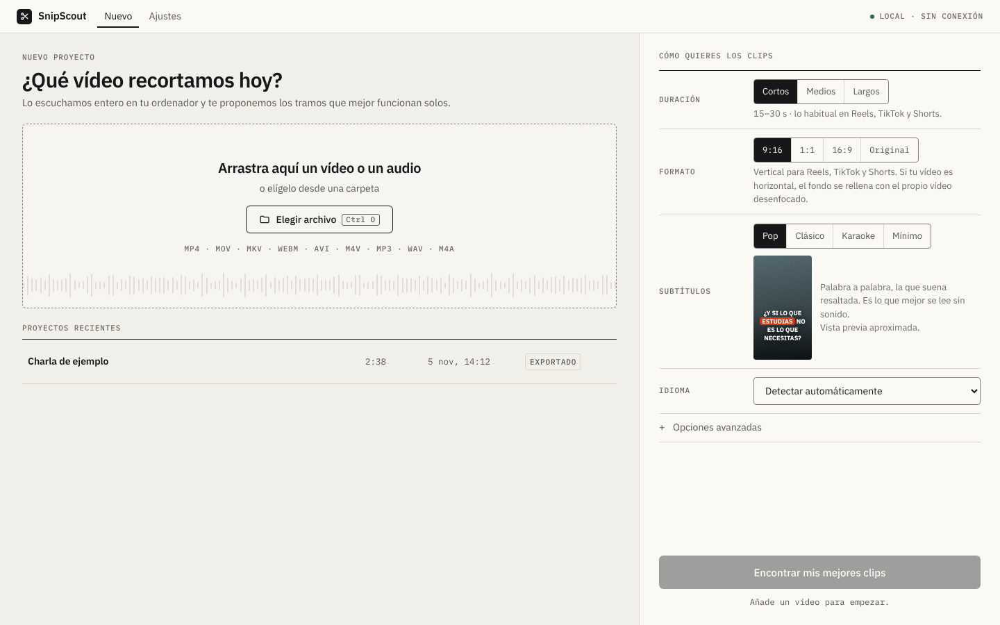
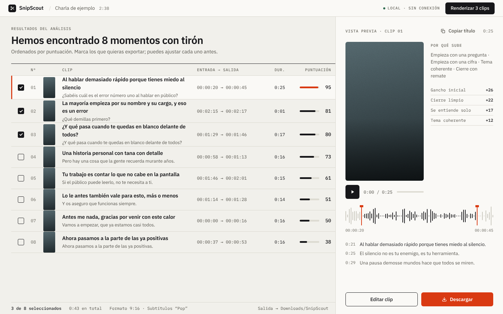
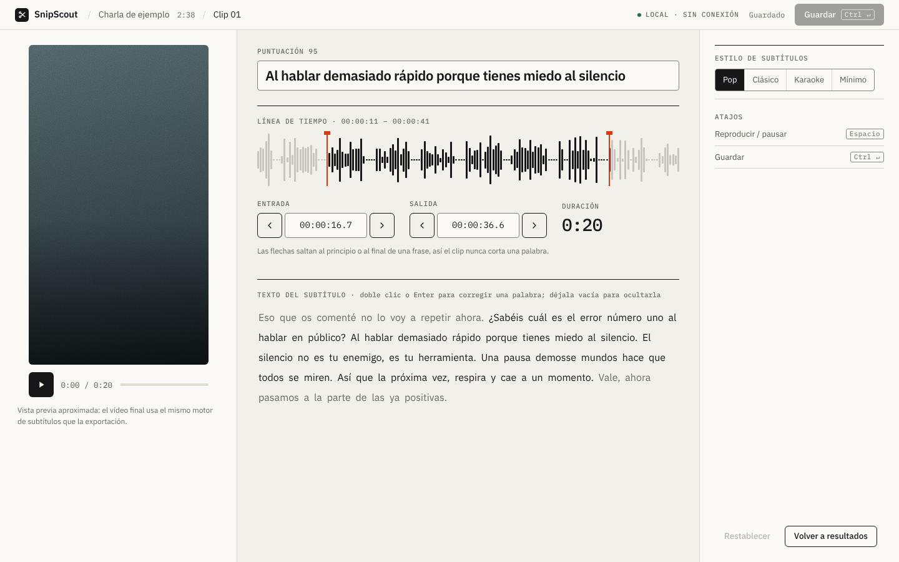
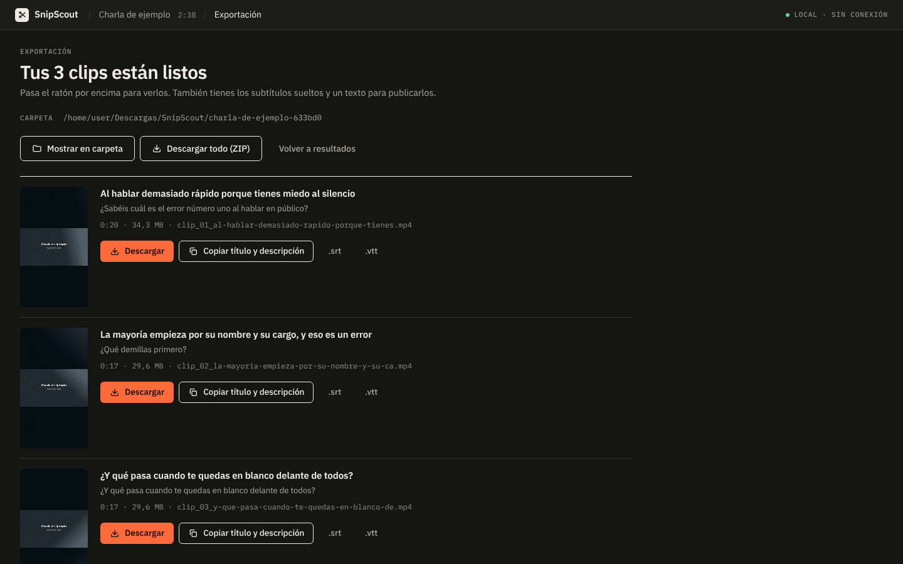
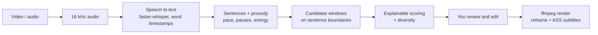

# SnipScout

**Turn a long video into short clips with word-by-word subtitles — on your own computer.**
No accounts, no API keys, no uploads. After a one-time model download it works fully offline.



| Start | Suggested moments | Clip editor | Finished clips (dark theme) |
|---|---|---|---|
|  |  |  |  |

<sub>Screenshots and GIF are generated by `scripts/make_screenshots.py --gif` from a demo talk with a synthetic voice.</sub>

## Why this exists

Cutting a talk, class or podcast into short clips usually means either hours of manual scrubbing or a paid
cloud service that uploads your footage. SnipScout does the boring part locally: it listens to the whole
video, proposes the moments that work on their own, and renders vertical clips with burned-in subtitles.
**It proposes; you decide.**

## Features

- Drag a video (or audio) file in; analysis runs on a normal laptop CPU — a GPU is used only if present.
- 10–15 suggested moments, each with a score and the reasons behind it ("opens with a question", "ends with a punchline"…).
- Clip editor with a waveform timeline: drag in/out handles that snap to sentences, scrub, zoom, fix any subtitle
  word (synced with playback), preview the exact exported frame, undo/redo and autosave.
- Projects history, "continue where you left off", and settings for output folder, quality and speech models.
- Export to 9:16, 1:1, 16:9 or original; vertical/square clips from wide videos fill the whole screen, cropped around
  the speaker's face (detected locally), with
  word-by-word highlighted subtitles (4 styles), plus `.srt`/`.vtt`,
  `metadata.json` and a ready-to-paste title and description per clip.
- Optional: re-rank the suggestions with a local Ollama model you already have (never downloaded by SnipScout).
- Spanish and English interface, light and dark themes, keyboard friendly, automated WCAG 2.1 AA checks (axe-core) on every screen.

## Install and start (step by step)

You don't need to know how to program. You need a computer with Windows 10/11, macOS or Linux, about **2 GB of free
disk space** and an internet connection **the first time only**.

### Windows

1. Open the [latest release](https://github.com/datamauriciovaldez/SnipScout/releases/latest) and click
   **`SnipScout-<version>-windows.zip`** to download it.
2. Go to your *Downloads* folder, right-click the ZIP → **Extract All…** → **Extract**.
   (Don't run it from inside the ZIP: it must be extracted first.)
3. Open the extracted folder and double-click **`Start-SnipScout.bat`**.
4. If Windows says *"Windows protected your PC"*, click **More info → Run anyway**. This appears because the file
   was downloaded from the internet.
5. A black window opens and asks to install a small helper called *uv* (about 30 MB): press **S** or **Y**.
   The first time it prepares everything for a few minutes; the next times it opens in seconds.
6. SnipScout opens in its own window. **Keep the black window open** while you use it — closing it closes the app.

To open it again later, double-click `Start-SnipScout.bat` again (tip: right-click it → *Send to → Desktop* for a
shortcut).

### macOS

1. Open the [latest release](https://github.com/datamauriciovaldez/SnipScout/releases/latest) and download
   **`SnipScout-<version>-macos-linux.tar.gz`**. Double-click it in *Downloads* to extract the folder.
2. In the folder, **right-click `Start-SnipScout.command` → Open → Open**. If macOS still refuses
   ("unidentified developer"), go to *System Settings → Privacy & Security* and click **Open Anyway**.
3. A Terminal window asks to install *uv*: type **y** and press Enter. The first time takes a few minutes.
4. SnipScout opens. Keep the Terminal window open while you use it.

(The macOS window has not been tested on a real Mac yet; if it doesn't open, SnipScout falls back to your browser.
Please [report it](https://github.com/datamauriciovaldez/SnipScout/issues).)

### Linux

Download the same `.tar.gz`, extract it, open a terminal in the folder and run:

```bash
./start-snipscout.sh
```

Without GTK or Qt webview libraries, SnipScout opens in your browser instead of its own window.

### First time in the app

1. Choose your language.
2. SnipScout checks your computer and suggests a speech model — **Balanced** is right for most people.
3. It downloads the model once (about 150 MB). After that, everything works **without internet**.
4. Drag a video onto the window (or click *Choose file*), pick the clip length and format, and press **Find my best clips**.
   You get a list of suggested moments: tick the ones you like, adjust them if you want, and export.
   Your clips land in *Downloads/SnipScout*.

### Update or uninstall

- **Update:** download the new release and start it the same way. Your projects and the speech model are kept
  (they live in your user folder, not in the app folder).
- **Uninstall:** delete the app folder. To also remove projects and models, delete the `SnipScout` folder in
  `%LOCALAPPDATA%` (Windows), `~/Library/Application Support` and `~/Library/Caches` (macOS) or
  `~/.local/share` and `~/.cache` (Linux). Your exported clips in *Downloads/SnipScout* are never deleted.

Something went wrong? The launcher leaves a `snipscout-error.log` file in its folder — see
[troubleshooting](docs/troubleshooting.md) or attach it to an [issue](https://github.com/datamauriciovaldez/SnipScout/issues).

<details>
<summary><b>Guía rápida en español</b></summary>

1. Entra en la [última versión](https://github.com/datamauriciovaldez/SnipScout/releases/latest) y descarga el
   archivo de tu sistema: **`…-windows.zip`** (Windows) o **`…-macos-linux.tar.gz`** (Mac y Linux).
2. **Descomprímelo** (Windows: clic derecho → *Extraer todo*; Mac: doble clic).
3. Abre la carpeta y ejecuta el lanzador:
   - **Windows:** doble clic en `Start-SnipScout.bat`. Si sale *"Windows protegió su PC"*: **Más información →
     Ejecutar de todas formas**.
   - **Mac:** clic derecho en `Start-SnipScout.command` → **Abrir → Abrir** (o *Ajustes del Sistema →
     Privacidad y seguridad → Abrir igualmente*).
   - **Linux:** en una terminal dentro de la carpeta, `./start-snipscout.sh`.
4. La ventana negra (o Terminal) pide instalar *uv*: pulsa **S** (o **y**) y Enter. La primera vez tarda unos
   minutos; las siguientes, segundos. **No cierres esa ventana** mientras uses SnipScout.
5. En la app: elige idioma, deja el modelo **Equilibrado** y espera la descarga (unos 150 MB, solo una vez).
   Después funciona **sin internet**.
6. Arrastra un vídeo, pulsa **Encontrar mis mejores clips**, marca los momentos que te gusten y exporta. Los clips quedan en
   *Descargas/SnipScout*.

Para actualizar, descarga la versión nueva y ábrela igual: tus proyectos se conservan.
</details>

### For developers

With [uv](https://docs.astral.sh/uv/getting-started/installation/) installed, one line on any system:

```bash
uv tool install git+https://github.com/datamauriciovaldez/SnipScout && snipscout ui
```

**Command line**: `snipscout run video.mp4 --count 3` analyzes and exports the top 3 clips; `snipscout doctor`
checks your setup.

## How it works



Clip selection uses **no language model** by default. A heuristic scorer combines seven signals — opening hook, pace,
vocal energy, topic cohesion, clean ending, whether it makes sense without context, and transcription
confidence — with weights in a single documented file (`src/snipscout/core/scoring/weights.toml`).
Titles, hooks and keywords are **extracted** from what was said, never generated. The suggestions are a
starting point: the editor is there because you know your content better.

**Optional local AI.** If you already run [Ollama](https://ollama.com) on your computer, *Improve with local AI*
asks a model you have installed to rate the top clips and suggest titles; the new order mixes its rating with the
heuristic score, and suggested titles are only applied when you click *Use*. SnipScout never downloads or bundles a
language model, only talks to Ollama on `127.0.0.1`, and treats the transcript as untrusted data (validated JSON
output, timeouts, and the heuristic result is kept if anything fails).

## 100% local & private

- Your files never leave your computer; there is no telemetry and no login.
- The only network access is the one-time speech-model download from Hugging Face (public, no token),
  and fetching `uv` / Python packages on first run. `SNIPSCOUT_OFFLINE=1` blocks any other connection.
- The local server listens on `127.0.0.1` only and requires a per-session token.

## Requirements & performance

Python 3.11+ (installed automatically by the launchers). Disk, measured on Linux: about 0.85 GB for Python,
the environment and the Fast model (+70 MB for Balanced), plus a ~0.6 GB download cache that uv keeps and you can
delete (`uv cache clean`); Windows sizes are not measured yet. 4 GB of RAM or more is recommended. Speech-to-text speed, measured with `scripts/benchmark.py` (transcription only,
each model in a fresh process, single run) on a 4-vCPU cloud container (Intel Xeon 2.8 GHz, no GPU) with a 2:38
synthetic Spanish voice (2026-11-06, v0.3 development):

| Speech model | Download | Time per minute of audio | Peak RAM |
|---|---|---|---|
| Fast (`tiny`) | 78 MB | ≈ 4.1 s | 0.43 GB |
| Balanced (`base`, default) | 148 MB | ≈ 5.4 s | 0.53 GB |
| Accurate (`small`) | 486 MB | ≈ 11.7 s | 0.79 GB |

A full `snipscout run` of the same talk with Balanced (audio extraction, transcription, scoring and one exported
vertical clip) took 40 s with the experimental bundle. A **2-hour** video (the same talk looped) took 11.6 min from file to three exported clips,
with 0.68 GB peak RAM, and the editor stayed responsive (transcript 1.2 MB, editor ready in under 1 s). Earlier v0.1 measurements on the same kind of machine were
about twice as slow (the cause was not isolated); treat all of these as indicative.

A 2:38 talk went from file to three exported vertical clips in 1 min 38 s with the Balanced model
(including its download). Laptop timings are **not measured yet**; SnipScout measures your machine's real
speed and adjusts its estimates after the first analysis.

## Limitations & roadmap

- **Selection quality is not yet better than chance on real speech.** On 6 real public-domain speeches (European
  Parliament, VoxPopuli, 17 moments annotated by one person), the top 5 suggestions caught 29 % of the moments;
  a random choice of 5 windows catches 38 %. Treat the ranking as a starting point and review all suggestions —
  that is why there are 12 and the editor exists. Details and how to help: [scoring](docs/scoring.md#5-tuning-and-honesty).
- Face-aware reframing follows one speaker (fixed crop, or a smooth pan when they move). With two people taking turns
  or camera cuts the automatic crop is centred; you can move it per clip in the editor (*Framing → Manual*).
  Tested with a single real face (static and moving) only.
- The preview in the app approximates the subtitle rendering; the exported file is the reference.
- Windows double-click launch verified on a real machine; the native window on macOS is **not yet verified**.
- An **experimental** self-contained folder build (PyInstaller, ~0.6 GB, unsigned) can be produced with the manual
  *Experimental bundle* workflow. Verified on Linux only (doctor + a full offline run); unsigned builds trigger
  SmartScreen/Gatekeeper warnings. The launcher ZIP remains the recommended install.
- Next: real-video tuning of the scorer with annotated talks, face-aware reframing, signed installers.

## Responsible use

Only process content you own or have permission to use. Respect copyright and each platform's rules
when you publish clips. SnipScout works on local files only; downloading videos from websites is out of scope.

## Architecture & contributing

`src/snipscout/core` is the processing engine (no UI imports), `web/` is the local API and the Preact frontend
(no build step), `desktop.py` opens the window. Docs: [architecture](docs/architecture.md), [local API](docs/api.md),
[how clips are chosen](docs/scoring.md), [troubleshooting](docs/troubleshooting.md). Contributions: see
[CONTRIBUTING](CONTRIBUTING.md), [Code of Conduct](CODE_OF_CONDUCT.md) and [security policy](SECURITY.md).

```bash
uv sync
uv run pytest
uv run snipscout ui
```

## License & credits

MIT © datamauriciovaldez. Speech recognition by [faster-whisper](https://github.com/SYSTRAN/faster-whisper)
(Whisper models, MIT). Fonts: IBM Plex and Inter (SIL OFL). Full list in
[`THIRD_PARTY_LICENSES.md`](THIRD_PARTY_LICENSES.md). ffmpeg is not redistributed in this repository.
