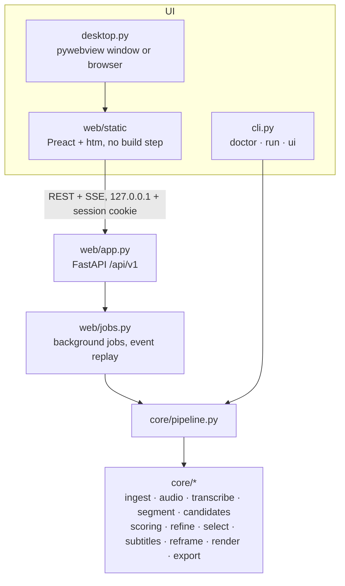

# Architecture

SnipScout is one Python package (`src/snipscout`) with three layers. The engine knows nothing about the UI.

## Rules the code follows

- `core/` never imports `web`, `cli` or `desktop`. Everything the UI and CLI do goes through `core/pipeline.py`.
- Long steps report progress as `JobEvent(stage, progress, message, params, state, error_code)` — `message` is an
  i18n key — and check a shared `CancelToken` (which also kills registered ffmpeg processes).
- Errors are `SnipScoutError` subclasses with stable `code`s; the UI maps each code to a translated help screen
  ([troubleshooting](troubleshooting.md)). No silent `except Exception`.
- `pathlib` everywhere; subprocesses take argument lists and timeouts, never `shell=True`. ffmpeg runs with the
  work folder as `cwd` and relative names inside filter strings (Windows drive letters break filter syntax).
- Network: only the one-time model download (pinned Hugging Face revisions, SHA-256 checked) and, if the user asks,
  their own Ollama on loopback. `core/net.py` patches the socket layer when `SNIPSCOUT_OFFLINE=1`.

## Analysis pipeline

| Stage | Module | What happens |
|---|---|---|
| prepare_audio | `ingest.py`, `audio.py` | Probe with ffprobe (or PyAV), extract 16 kHz mono WAV of the chosen track. |
| transcribe | `transcribe.py`, `modelstore.py` | faster-whisper (CTranslate2, CPU int8; GPU if present) in 5-minute chunks fed as float32 arrays. The last segment of each chunk is redone in the next one; progress is saved, so an interrupted analysis resumes. Measured speed is stored in `<cache>/speed.json` for honest ETAs. |
| understand | `segment.py` | Words → sentences (punctuation, 0.6 s pauses, 40-word cap) with pace, pauses, fillers, confidence and RMS dynamics. |
| find_moments | `candidates.py`, `scoring/`, `refine.py`, `select.py`, `text/` | Windows that start and end on sentence boundaries, cheap shortlist, full [scoring](scoring.md), MMR diversity, extractive titles/hooks/keywords. Top 3 pre-ticked. |

Rendering (`render` job): `subtitles.py` builds an ASS file with one event per word (3–5 word lines),
`reframe.py` picks centre crop, blurred background or — via `faces.py` (YuNet on onnxruntime, ~1 frame/s of the clip) —
a fixed crop centred on a steadily visible speaker, `render.py` runs ffmpeg (libx264, or a hardware encoder with
fallback; optional loudnorm), `export.py` writes `clip_NN_slug.mp4/.srt/.vtt`, `metadata.json` and `captions.txt`.

Optional `improve` job: `scoring/ollama.py` asks a local Ollama model to rate the top clips (see [scoring](scoring.md)).

## Where data lives

Defaults come from `platformdirs` (app name `SnipScout`) and can be overridden:

| What | Default | Override |
|---|---|---|
| Projects, models, uploads, preferences | user data dir | `SNIPSCOUT_DATA_DIR` |
| Disposable caches (ffmpeg probe, speed stats) | user cache dir | `SNIPSCOUT_CACHE_DIR` |
| Exported clips | `Downloads/SnipScout/<project>` (or Settings) | `SNIPSCOUT_OUTPUT_DIR` |

A project folder holds `project.json`, `transcript.json`, `clips.json`, `audio.wav`, thumbnails and waveform caches.
JSON files are written atomically.

## Frontend

`web/static` is served as-is: Preact 10 + hooks and htm via an import map (vendored), a hash router
(`#/`, `#/proyecto/:id`, `#/proyecto/:id/clip/:cid`, `#/proyecto/:id/exportar`, `#/proyectos`, `#/ajustes`,
`#/bienvenida`), a tiny store, and i18n from `i18n/es.json` / `en.json` (a test fails on missing keys).
All colours come from `css/tokens.css` (light and dark, AA-checked by `scripts/check_contrast.py`).

## Desktop shell

`snipscout ui` starts uvicorn on a free `127.0.0.1` port in a thread, then opens a pywebview window with the
one-time session link. If no webview backend is available (e.g. Linux without GTK/Qt) it opens the default browser.

## Quality gates

`ruff`, strict `mypy`, `pytest` (Linux, Windows, macOS), contrast check, licence check, UI smoke test in Chromium,
component gallery check, informational `pip-audit`, weekly slow tests with a real model. Accessibility:
`scripts/check_a11y.py` (axe-core rules, 40 px targets, keyboard walk, 200 % zoom).
